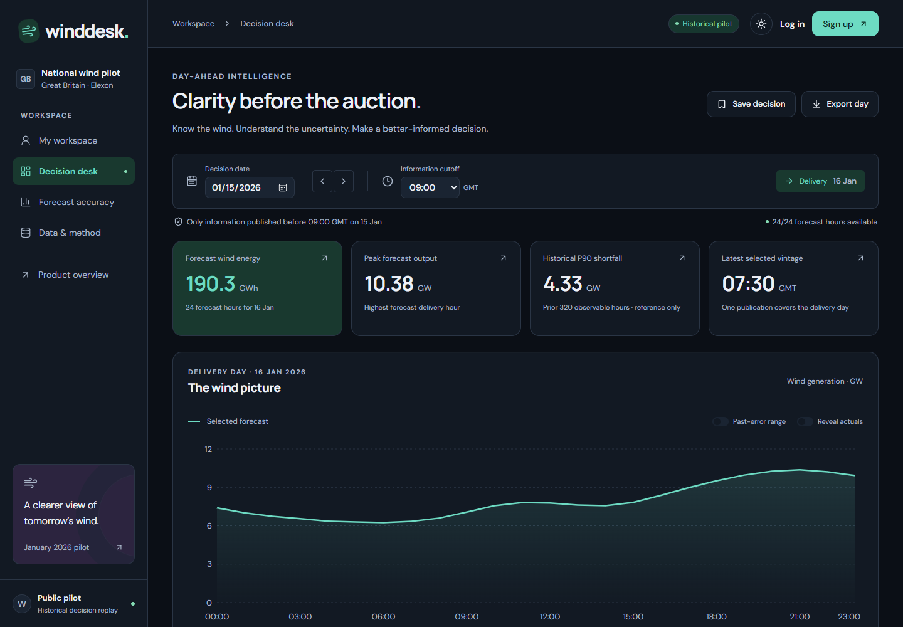
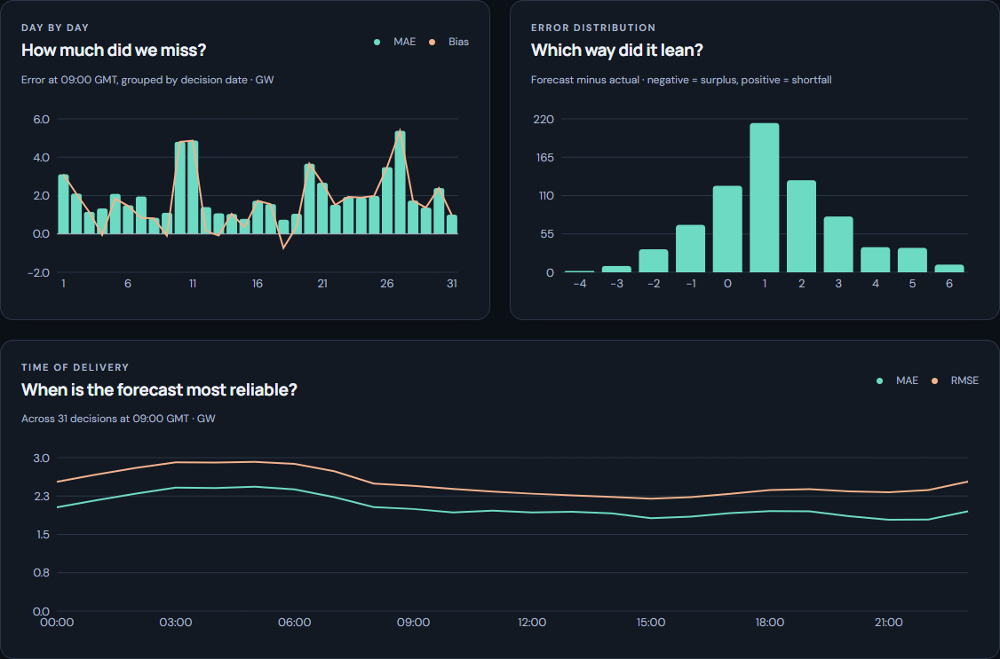
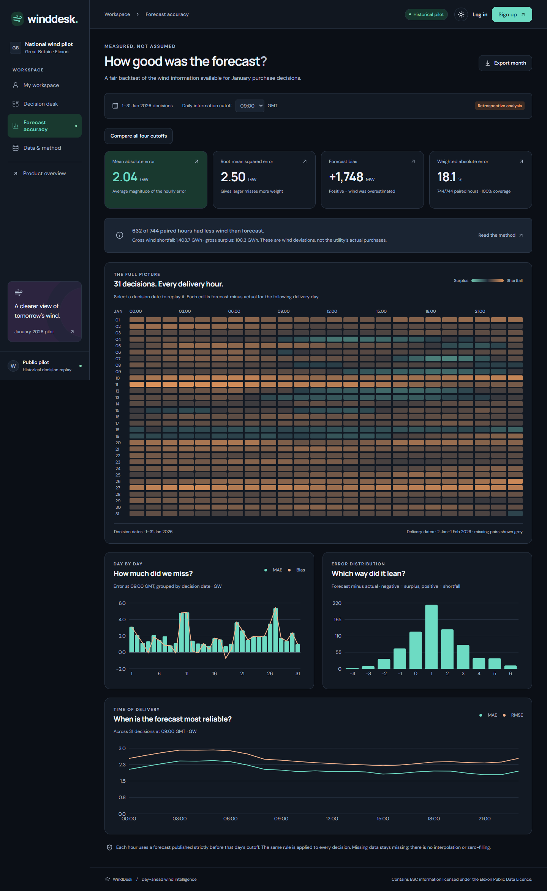
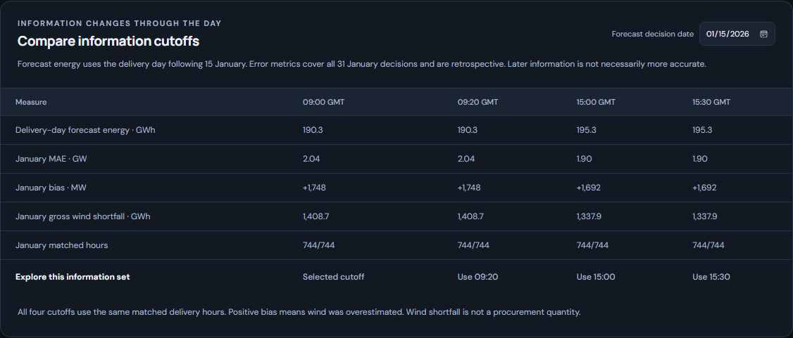
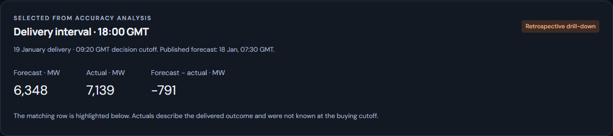
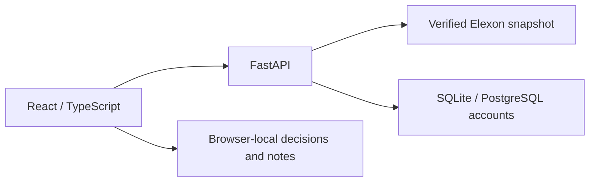

# WindDesk — Day-Ahead Wind Analytics

**Point-in-time wind forecasts and accuracy analysis for Great Britain's electricity market.**

WindDesk helps a utility's day-ahead purchasing team answer two questions: **what wind forecast was available before the buying decision, and how accurately did it describe the delivered outcome?** It combines an interactive React interface with a Python analytical API and a reproducible snapshot of genuine Elexon data.

The pilot covers **1–31 January 2026 purchase decisions**, corresponding to **2 January–1 February delivery**. Prepared for the REint Full Stack SWE challenge v4 Shared.

[Quick start](#quick-start) · [Analytics](#analytics-and-results) · [Architecture](docs/ARCHITECTURE.md) · [Verification](docs/VERIFICATION.md) · [Deployment](docs/DEPLOYMENT.md)



## Product capabilities

| Workspace | Capability |
| --- | --- |
| **Decision desk** | Replay the latest eligible forecast for each delivery hour, inspect publication history and lead time, and export the selected day to CSV. |
| **Forecast accuracy** | Evaluate MAE, RMSE, bias, WAPE, coverage and wind shortfall/surplus through daily charts, delivery-hour profiles and an interactive error heatmap. |
| **Cutoff comparison** | Compare four information sets side by side. Distinguish selected-day forecast energy from January-wide accuracy and verify matched-hour comparability. |
| **Interval drill-down** | Open an individual heatmap hour, inspect its forecast publication and outcome, and focus the matching table row. Date, cutoff and selected hour are shareable through the URL. |
| **Data & method** | Inspect source endpoints, record counts, checksums, selection rules and recorded upstream verification evidence. |
| **Personal workspace** | Save decisions and notes, resume an analysis, search and sort saved items, and recover a removed decision with Undo. |

The interface supports day/night themes, three accent palettes, keyboard navigation and responsive layouts. Accounts provide signup, login, profile/password management and persistent theme/cutoff preferences. Public analysis remains accessible without an account.

## Analytics and results

These screenshots are captured from the running application using the bundled Elexon snapshot. The charts show daily forecast error, signed-error distribution and accuracy by delivery hour.



At the **09:00 GMT cutoff**, the January cohort contains:

| Measure | Recorded result |
| --- | ---: |
| Matched delivery hours | **744 / 744** |
| Mean absolute error | **2,038.91 MW** |
| Root mean squared error | **2,504.76 MW** |
| Signed bias | **+1,747.89 MW** |
| Weighted absolute percentage error | **18.07%** |
| Hours with less wind than forecast | **632 / 744** |

Positive bias means wind was overestimated. These are retrospective national-wind results for one month; they do not establish a utility's purchase requirement or a persistent forecasting advantage. See [analysis and interpretation](docs/ANALYSIS.md).

<details>
<summary><strong>Explore the analytical interface</strong></summary>

### Forecast accuracy dashboard

Monthly metrics, the 31 × 24 delivery-hour heatmap and error breakdowns are available in one workspace.



### Compare information cutoffs

The same matched delivery hours are compared at 09:00, 09:20, 15:00 and 15:30 GMT. Later information is explicitly separated from the morning decision.



### Inspect an individual delivery hour

Selecting a heatmap cell opens its original decision context, identifies the forecast publication and highlights the matching interval. Actuals are labelled as retrospective information.



### Day mode and personal workspace

[Day-mode decision desk](docs/screenshots/decision-desk.png) · [Day-mode comparison](docs/screenshots/cutoff-comparison-light.png) · [Saved decisions and notes](docs/screenshots/personal-workspace.png) · [Mobile workspace](docs/screenshots/mobile-workspace.png) · [Account interface](docs/screenshots/account-signup.png)

</details>

## Quick start

### Docker

**Prerequisite:** Docker Desktop with Linux containers, or Docker Engine with Compose. Run from the repository root:

```sh
docker compose up --build -d
```

- Application: [http://localhost:8000](http://localhost:8000)
- Interactive API documentation: [http://localhost:8000/api/docs](http://localhost:8000/api/docs)
- Health endpoint: [http://localhost:8000/api/health](http://localhost:8000/api/health)

The container builds and serves both frontend and API, includes the verified historical snapshot, and runs as a non-root user with a read-only filesystem. Account storage uses a persistent named volume. No Elexon API key or external service account is required locally.

Stop with `docker compose down`; the account volume is preserved.

<details>
<summary><strong>Run without Docker</strong></summary>

Prerequisites: **Python 3.13** and **Node.js 22.14 or later in the Node 22 line**.

**Windows / PowerShell**

```powershell
powershell -ExecutionPolicy Bypass -File scripts/start.ps1
```

The script installs locked dependencies, builds the frontend and starts FastAPI. Append `-Port 8080` to select another port. The execution-policy setting applies to this process only.

**macOS / Linux**

```sh
sh scripts/start.sh
```

Use `PORT=8080 sh scripts/start.sh` for another port. Both launch paths serve `http://localhost:8000` by default.

**Development with hot reload**

```powershell
python -m venv .venv
.venv\Scripts\python.exe -m pip install -r requirements-dev.txt
.venv\Scripts\python.exe -m uvicorn backend.app:app --reload
```

On macOS/Linux, use `python3` and `.venv/bin/python` for the equivalent commands. In a second terminal:

```sh
npm ci
npm run dev
```

Open [http://localhost:5173](http://localhost:5173). Vite forwards `/api` requests to FastAPI on port 8000. Production serves both layers from the same origin.

</details>

## Data and analytical method

**Sources:** Elexon [WINDFOR/stream](https://bmrs.elexon.co.uk/api-documentation/endpoint/datasets/WINDFOR/stream) forecasts and [FUELHH/stream](https://bmrs.elexon.co.uk/api-documentation/endpoint/datasets/FUELHH/stream) actuals, restricted to `fuelType=WIND`. No weather, demand, prices or third-party generation data are added.

The app serves an immutable historical snapshot rather than contacting Elexon on every page load. It contains **17,864 forecast records** and **1,488 actual half-hours**, with source URLs and SHA-256 evidence retained. An independent check on **25 October 2026 at 21:20 UTC** matched all **19,352 in-scope records** across 64 official requests. This records verification at that time, not a continuous live-data guarantee. [Source-comparison evidence](data/upstream-verification.json)

| Decision | Implementation |
| --- | --- |
| **Forecast availability** | For each target hour, select the maximum `publishTime` strictly before the decision cutoff. Exactly-at-cutoff records are excluded; partial vintages can fall back to earlier publications. |
| **Resolution alignment** | January WINDFOR records are hourly. Actuals are the mean of both FUELHH half-hour MW readings; missing halves remain missing. No synthetic half-hour forecasts are created. |
| **Time and scope** | January decisions use GMT / Europe/London. Elexon aggregates represent GB metered wind, not every UK renewable source or a utility's portfolio. |
| **Cutoff assumptions** | 09:00 is an illustrative preparation cutoff, not a confirmed client deadline. Other presets explore different information sets; afternoon publications cannot improve a historical morning decision. |
| **Retrospective outcomes** | Actuals are hidden by default and explicitly revealed for evaluation. The snapshot contains downloaded actual revisions, not a reconstruction of every historical revision. |
| **Historical error reference** | Uses only earlier January errors whose actual publications precede the selected cutoff. Requires 48 observable hours and is labelled an empirical reference, not a calibrated prediction interval. |

For a matched hour, `error = forecast − actual` in MW. MAE measures average absolute error; RMSE gives larger misses more weight; bias retains the sign. WAPE divides total absolute error by total actual generation and is undefined when that denominator is zero. Gross shortfall and surplus sum the positive and negative parts separately, in MWh, so opposite errors do not cancel.

National wind error is only one input to procurement. Demand, contracted supply, portfolio share and prices are outside this pilot. [Full methodology](docs/ARCHITECTURE.md) · [Challenge alignment](docs/CHALLENGE_ALIGNMENT.md)

## Architecture and technology

| Layer | Implementation |
| --- | --- |
| Interface | React 19, TypeScript, Vite, Recharts and Lucide |
| Client state | Reducer and URL state, bounded public-response cache, abortable requests and deferred chart rendering |
| API and analysis | Python 3.13, FastAPI, Pydantic response contracts and deterministic point-in-time analysis |
| Persistence | Versioned compressed analytical snapshot; SQLite locally/in Docker or PostgreSQL for hosted accounts |
| Quality | pytest, Vitest, Playwright, axe accessibility checks and a configured GitHub Actions workflow |
| Delivery | Multi-stage Docker image; Vercel frontend/Python entrypoint configuration |



Passwords are salted and hashed; sessions use opaque HttpOnly cookies with expiry and revocation. Profile, theme and cutoff preferences persist with the account. Saved decisions and notes are **browser-local**, separated by guest/account workspace, and do not sync across devices. Unsaved-note navigation guards, Undo removal, request timeouts and rendering boundaries provide recovery paths.

Hosted Vercel accounts require a persistent PostgreSQL `DATABASE_URL` and secure-cookie configuration. Public guest analysis does not depend on an account database. [Account configuration](docs/UI_AND_ACCOUNTS.md)

## Repository structure

```text
backend/
  domain.py              Validation, forecast selection, alignment and metrics
  app.py                 Versioned API, CSV, health, logging and static serving
  schemas.py             Typed API response contracts
  provenance.py          Snapshot-bound upstream verification evidence
  auth.py                Accounts, password hashing, sessions and preferences
api/index.py             Vercel ASGI entrypoint
src/
  App.tsx                Decision desk, accuracy, provenance and URL state
  Home.tsx               Product overview and deferred real-data previews
  Charts.tsx             Lazy-loaded forecast and accuracy visualizations
  CutoffComparison.tsx   Four-cutoff analysis with matched-hour checks
  Workspace.tsx          Saved decisions, notes, search, sorting and Undo
  Account.tsx            On-demand authentication and profile management
  NavigationGuard.tsx    Unsaved-note navigation protection
  ErrorBoundary.tsx      Rendering and bundle-load recovery
  api.ts / types.ts      Data fetching and frontend contracts
  theme.ts / format.ts   Appearance, units and timestamp formatting
  performance.ts        Opt-in Web Vitals measurement
  *.css                  Responsive day/night interface and print styles
data/                    Original compressed records, manifest and verification report
scripts/                 Startup, ingestion, source verification, smoke checks,
                         performance measurement and source packaging
tests/                   Python tests and an independent forecast-selection oracle
e2e/                     Desktop/mobile workflows and accessibility checks
docs/                    Architecture, analysis, deployment, demo and verification
docs/screenshots/        Screenshots captured from the running application
.github/workflows/ci.yml Test, build, container and performance-artifact workflow
Dockerfile / compose.yaml  Container build and persistent local runtime
vercel.json              Frontend and Python function deployment configuration
requirements*.txt       Python dependency inputs and runtime lockfile
package*.json            Frontend dependencies and exact npm lockfile
```

## Verification and reproducibility

Recorded local results:

| Check | Evidence |
| --- | --- |
| Python domain, API, provenance and SQLite accounts | **62 tests passed** |
| PostgreSQL accounts | **19 additional tests passed** against a disposable database |
| React components and data hooks | **9 tests passed** |
| Desktop/mobile browser scenarios | **50 distinct checks passed**, including affected-flow reruns |
| Responsive inspection | **30 layouts** checked with no page overflow |
| Production build and runtime | TypeScript/Vite build, Docker build, API/CSV smoke checks and account persistence verified locally |

The test history, accessibility evidence, dependency checks and tooling limitations are recorded in [VERIFICATION.md](docs/VERIFICATION.md). CI is configured; a successful hosted workflow or public deployment is not claimed by these local results.

**Python tests — Windows / PowerShell**

```powershell
python -m venv .venv
.venv\Scripts\python.exe -m pip install -r requirements-dev.txt
.venv\Scripts\python.exe -m pytest
```

On macOS/Linux, use `python3` and `.venv/bin/python` instead. For Windows temporary-directory permission issues, see the [verification notes](docs/VERIFICATION.md#issues-discovered-and-resolved-during-verification).

**Frontend and browser tests**

```sh
npm ci
npm test
npm run build
npm run format:check
npx playwright install chromium
npm run test:e2e
```

Browser tests start the production API automatically if port 8000 is free. To use installed Edge, set `PLAYWRIGHT_CHANNEL=msedge` instead of downloading Chromium.

**Running-app checks and performance measurements**

```sh
python scripts/smoke.py --base-url http://127.0.0.1:8000
node scripts/performance.mjs --runs 3
```

The performance report records desktop and throttled-mobile lab samples, not real-user p75 statistics. Some mobile LCP/INP targets remain unmet. [Measured results and limitations](docs/OPTIMIZATIONS.md)

<details>
<summary><strong>Refresh or independently verify the source snapshot</strong></summary>

Neither command is needed for ordinary startup. Ingestion uses the public JSON API at `https://data.elexon.co.uk/bmrs/api/v1/datasets/` and only the two permitted datasets.

```sh
python scripts/ingest.py
python scripts/verify_upstream.py
```

Ingestion validates records, retains relevant publication vintages, records response hashes and replaces files atomically. The verifier re-fetches all 64 source requests and compares every original in-scope field after timestamp normalization. It exits nonzero on differences or unavailable responses and saves its report without changing generation data.

Investigate differences before release. Restart/rebuild after a refresh; runtime integrity checks bind verification evidence to the current data hashes. Ingestion is an operator command, separate from public API requests.

</details>

## Deployment and documentation

**Hosted application:** pending deployment. **Demo video:** pending recording/upload. Deployment configuration and the two-part presentation script are included; verified public URLs must be added before challenge submission.

| Document | Purpose |
| --- | --- |
| [Architecture](docs/ARCHITECTURE.md) | System design, API, data rules and tradeoffs |
| [Analysis](docs/ANALYSIS.md) | January results and interpretation |
| [Optimizations](docs/OPTIMIZATIONS.md) | Research, recovery behavior and performance methodology |
| [Deployment](docs/DEPLOYMENT.md) | Vercel, Docker, PostgreSQL and access verification |
| [Demo script](docs/DEMO_SCRIPT.md) | Customer and technical walkthrough, planned under ten minutes |
| [Submission guide](docs/SUBMISSION.md) | Repository, video, public links and final access checks |

Create a source-only handoff archive with `python scripts/package.py`. The resulting `artifacts/WindDesk-source.zip` excludes credentials, account databases, dependencies and generated build output.

## AI assistance and data attribution

**OpenAI Codex assisted with domain research, implementation, UI design, documentation and test generation.** The application does not call an LLM or generate synthetic wind data. Analytical outputs are derived from the retained Elexon records.

Contains BSC information licensed under the [Elexon Public Data Licence](https://www.elexon.co.uk/bsc/documents/data/open-data-requests/bsc-public-data-licence/). Self-hosted font licences are included in `public/fonts/`.

[WINDFOR documentation](https://bmrs.elexon.co.uk/api-documentation/endpoint/datasets/WINDFOR/stream) · [FUELHH documentation](https://bmrs.elexon.co.uk/api-documentation/endpoint/datasets/FUELHH/stream) · [Elexon wind generation](https://bmrs.elexon.co.uk/wind-generation)
