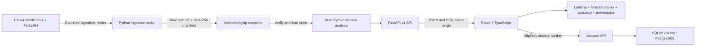

# Design and technical review

## System overview

Docker packages the compiled React application, FastAPI and immutable snapshot in one image. Vercel serves Vite output through its CDN and the same FastAPI app through `api/index.py`. Ingestion is an explicit offline operation rather than a public endpoint. The pilot's historical month never requires live upstream requests during use.

## Boundaries and responsibilities

`backend/domain.py` contains all selection, validation, alignment, quantiles and metrics. It has no FastAPI dependency. `Dataset` indexes forecast vintages by target time, sorts publication times once and uses binary search for strict-before selection. Latest actual publications are indexed by half-hour. A complete hour requires both half-hours. No pandas dependency is needed for 744 hourly observations; the standard-library implementation is small enough to inspect.

`backend/app.py` handles parameter validation, response serialization, CSV, request IDs, structured timing logs, cache headers, health checks and static serving. Explicit Pydantic output contracts in `backend/schemas.py` reject accidental schema drift. `/api/v1` is stable and its field names include units. An absent or corrupt snapshot returns 503; invalid dates/cutoffs return 422. There is no synthetic fallback. Cached read-only month results avoid repeated work; per-day views construct fresh dictionaries so reference-band fields never mutate cached results.

FastAPI synchronous analysis routes run in its worker thread pool. The HTTP middleware is asynchronous. An artificial asynchronous wrapper would not improve these small CPU computations. Upstream HTTP requests are confined to ingestion, which uses four workers, timeouts and bounded exponential retries. A production live ingest service could use an async client or a job queue, but neither is needed inside request handling for this fixed cohort.

`src/App.tsx` owns the landing page, personal workspace and three analytical views and a small reducer for the shared decision date, view and cutoff. Those filters are validated when read from the URL, then persisted for reproducible links. Hindsight visibility, historical reference visibility, table sorting and publication expansion belong to the components that use them. `useApi` cancels obsolete fetches, rejects responses after cancellation, clears stale data when dependencies change, and exposes explicit loading/error/retry states. Components never recompute the authoritative domain metrics. Recharts is lazy-loaded to keep chart code out of the first shell chunk.

The current JSX groups related product views in one file for review convenience within the assignment timebox. A larger team could extract the views into separate modules without changing domain or HTTP boundaries. The TypeScript and Pydantic contracts are maintained in parallel; contract generation would be appropriate if the API grew.

Account forms and themes are isolated in `src/Account.tsx`, with landing content and real-data previews in `src/Home.tsx`. `backend/auth.py` handles password hashing, durable sessions, origin checks, rate limits and preferences. Session tokens are never stored in browser localStorage. See [account design](UI_AND_ACCOUNTS.md) for persistence, deployment and scope.

## API contract

| Method + route | Parameters | Purpose |
| --- | --- | --- |
| GET `/api/health` | none | Snapshot readiness, retrieval timestamp and source coverage |
| GET `/api/v1/day` | `decision_date`, `cutoff` | 24 delivery hours, selection timestamps, metrics, earlier-error reference |
| GET `/api/v1/overview` | `cutoff` | 31 decisions, aggregate metrics, hourly profile and distribution |
| GET `/api/v1/publications` | `decision_date`, `cutoff` | All delivery-day vintages, eligibility and selected hour counts |
| GET `/api/v1/provenance` | none | Manifest, file hashes, upstream requests and methodology |
| GET `/api/v1/export.csv` | `cutoff`, optional `decision_date` | Auditable month/day CSV with exact selection and actual publication times |
| GET `/api/docs` | none | OpenAPI interactive documentation |
| GET `/api/auth/session` | session cookie | Authenticated profile or public guest |
| POST `/api/auth/signup`, `/api/auth/login` | JSON credentials; name on signup | Persistent account and rotating session |
| PUT `/api/auth/profile` | authenticated session, display name | Update profile |
| POST `/api/auth/password` | authenticated session, current/new passwords | Replace password, revoke other sessions and rotate current session |
| POST `/api/auth/logout` | session cookie, JSON body | Server-side session revocation |
| PUT `/api/auth/preferences` | authenticated session, theme/cutoff JSON | Save account preferences |

Dates outside 1–31 January decisions are rejected. API cutoffs accept valid zero-padded `HH:MM` times; the interface exposes four meaningful presets. Date and cutoff inputs are constrained rather than used as filenames or upstream query fragments. CSV fields are server-generated numbers, booleans and validated timestamps, not arbitrary user text.

## Data quality and leakage controls

- Ingest only `FUELHH` WIND and `WINDFOR`. Keep the original fields rather than pre-joining a convenient final forecast.
- Restrict targets to 2 January–1 February and forecast publications to before 1 February. Include December vintages only as potential fallback information for January decisions.
- Deduplicate by `(startTime, publishTime)`; reject conflicts. Verify finite, non-negative generation, timezone-aware timestamps and the observed source resolution.
- Compare hourly wind forecasts against the mean of both half-hour actuals. Missing pairs remain null and reduce coverage.
- Require `publishTime < decisionCutoff` separately for every target. A final historical forecast can never overwrite an earlier decision's selected vintage.
- For the past-error reference, require earlier decision dates **and** actual publication times strictly before the current cutoff. No full-month calibration enters the decision-day chart.
- Treat final actuals as retrospective. Their revisions are not equivalent to what the desk knew in real time. Training includes a final actual only when that stored publication timestamp was observable.
- Verify bundled compressed-file hashes and row counts on the first load. Record hashes of each upstream response. Identical rows create deterministic gzip content; retrieval timestamps remain variable.

The snapshot is immutable during runtime. Each output file is atomically replaced during ingestion; the manifest is replaced last. A partial refresh fails hash verification rather than serving a silently mixed snapshot. Restart/redeploy after a completed refresh. Concurrent manual ingestions into the same output folder are unsupported.

## Verification strategy

Domain tests cover exact-cutoff exclusion, per-target fallback, duplicate conflicts, zeros, missing halves, latest actual revisions, invalid timestamps/resolution, January/February boundaries, metric sign and energy units, quantiles and future-actual leakage. A deliberately separate raw-record oracle checks all 744 selections and actual pairings at each of the four UI cutoffs.

API tests verify validation status codes, readiness failure, CSV dimensions, provenance, documentation and day/month consistency. React tests cover loading, error/retry, shareable filters and aborted stale requests. Playwright exercises the production build on desktop and mobile. Axe checks WCAG A/AA issues on the main views; it is useful automated evidence, not a claim of complete accessibility certification. CI repeats the checks on Linux and builds/smoke-tests the container.

## Operational choices

- **Analysis storage:** the immutable compressed snapshot remains sufficient for the energy analysis; account records are separate operational data.
- **Accounts:** the requested extension adds SQLite locally/in Docker and PostgreSQL on Vercel, password hashing, opaque sessions and saved preferences. Public Elexon analysis remains anonymously accessible. Organization/portfolio authorization would need a separate access model.
- **Mutations:** public signup/login and authenticated preferences are handled by `backend/auth.py`. Ingestion remains an operator command. Compose provides one writable account volume; other runtime files remain read-only.
- **Cache discipline:** verified immutable results use a bounded 48-entry in-process cutoff cache and one-hour browser/CDN freshness headers. Errors are not cached. A refreshed dataset requires process restart/redeployment; browser/CDN TTL is at most one hour for old responses.
- **Observability:** request ID, path, HTTP status and duration are structured logs. Health validates availability of the snapshot. Do not log credentials or portfolio data if scope grows.
- **Container:** multi-stage build, slim runtime, UID 10001, healthcheck, Compose read-only filesystem, dropped capabilities and no privilege escalation. `PORT` is configurable for container hosts.
- **Reproducibility:** npm lockfile, exact Python runtime lock, versioned data and automated CI. Base image tags follow patched Node/Python lines; digest pinning with an update policy is a production follow-up.

## What comes next if the pilot is accepted

Validate the client's actual auction and operational cutoff, portfolio ownership/share, forecast and actual measurement populations, and demand inputs. Establish longer historical coverage and an out-of-sample, rolling, day-blocked calibration/evaluation plan. Add durable raw-vintage storage, scheduled asynchronous ingestion, freshness/error alarms and a controlled refresh workflow. Introduce authenticated portfolio views and quantify residual supply against demand. Only then add pricing, risk limits and purchase workflows, with explicit operator approval. None of those unavailable inputs is fabricated in this assignment.

Workspace notes and saved decisions are intentionally browser-local metadata, scoped to guest/account IDs. No extra energy dataset is added. Password updates and session creation coordinate with database locks so an in-flight login validated against an old hash cannot establish a session after that hash is replaced.
